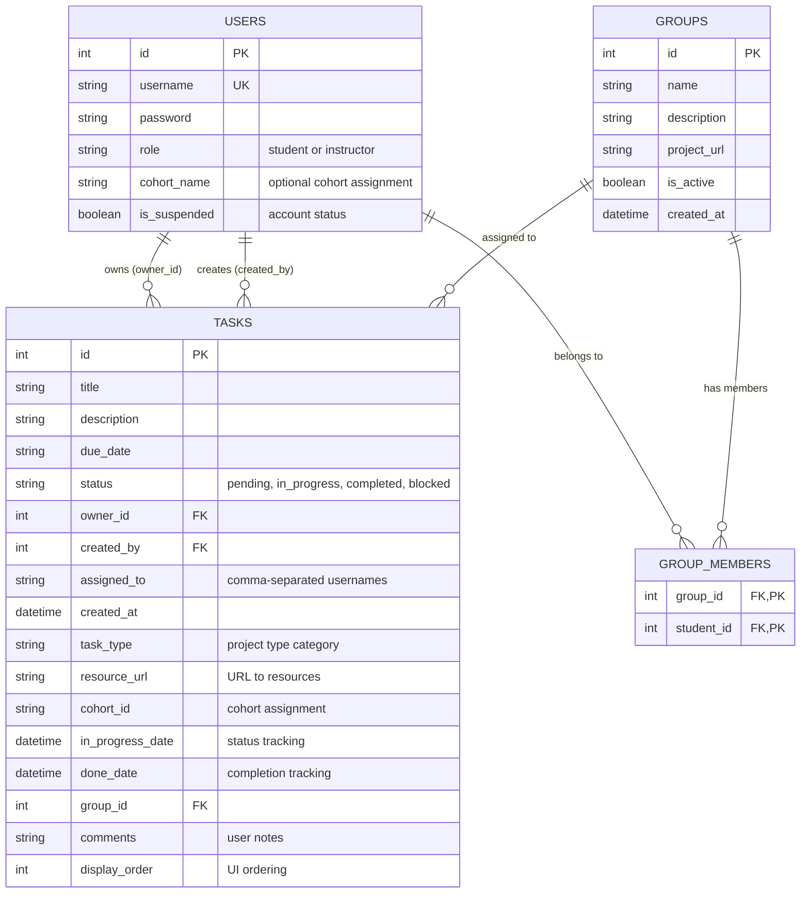
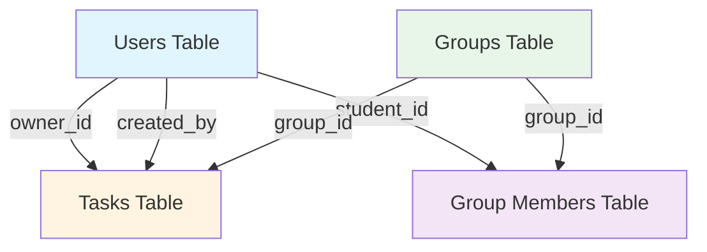
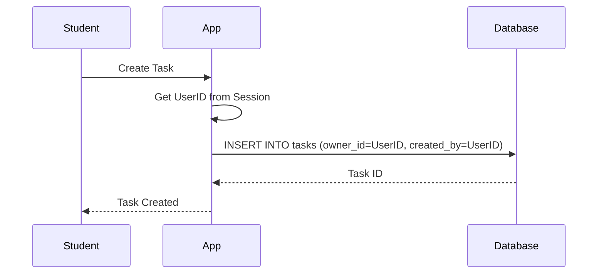
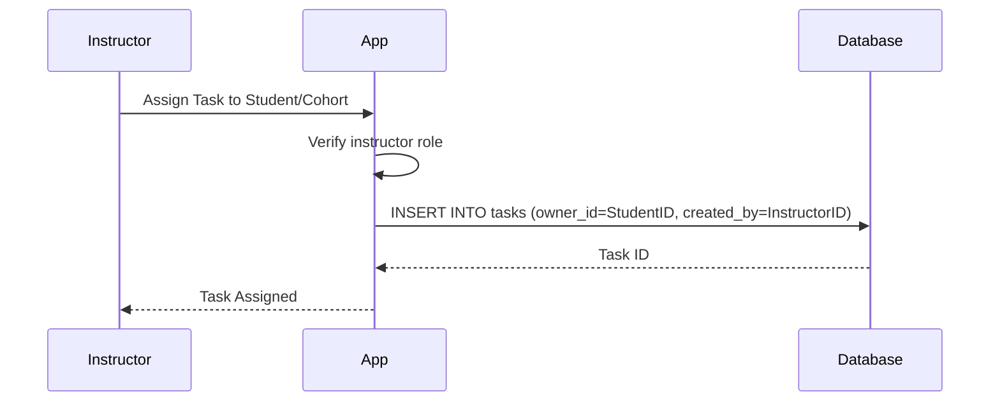
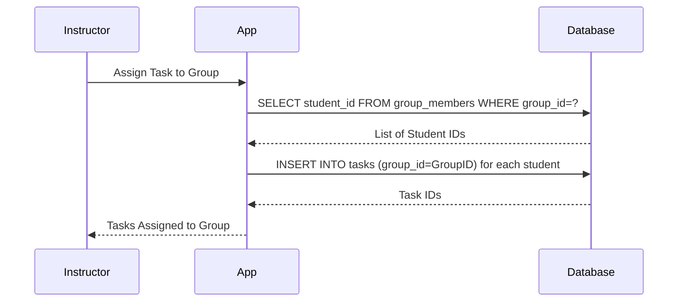
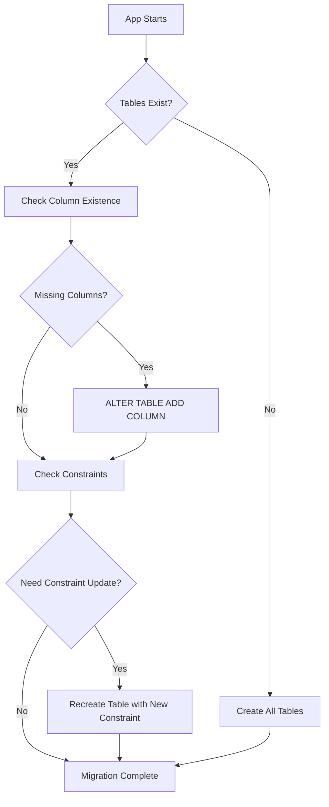

# TaskFolio Data Model

## Overview

This document provides a comprehensive technical description of the TaskFolio data model, including Entity-Relationship Diagrams (ERD), entity definitions, relationships, and usage patterns in the application.

TaskFolio is a multi-tenant task management system for coding bootcamp students and instructors. The data model supports:
- Role-based access (students and instructors)
- Task creation and assignment
- Cohort-based organization
- Group collaboration
- Task status tracking with timestamps

## Entity-Relationship Diagram



## Detailed Entity Relationships



## Data Entities

### 1. Users

**Purpose**: Stores account information for both students and instructors in the system.

**Schema**:
```sql
CREATE TABLE users (
    id INTEGER PRIMARY KEY AUTOINCREMENT,
    username TEXT UNIQUE NOT NULL,
    password TEXT NOT NULL,
    role TEXT NOT NULL CHECK(role IN ('student', 'instructor')),
    cohort_name TEXT,
    is_suspended BOOLEAN DEFAULT 0
);
```

**Fields**:
- `id` - Auto-incrementing unique identifier
- `username` - Unique login username
- `password` - User password (⚠️ **plain text in demo version - NOT production-ready**)
- `role` - User role, constrained to 'student' or 'instructor'
- `cohort_name` - Optional cohort assignment (e.g., "Java11.2", "Data6.2")
- `is_suspended` - Account suspension flag (0=active, 1=suspended)

**Relationships**:
- One user can own many tasks (one-to-many via `tasks.owner_id`)
- One user can create many tasks (one-to-many via `tasks.created_by`)
- Students can be members of multiple groups (many-to-many via `group_members`)

**Usage in Application**:
- Authentication and authorization
- Task ownership and assignment
- Cohort-based filtering and organization
- Role-based access control (students vs instructors)
- Account management (suspension)

**Security Note**: This is a demo/educational application. Passwords are stored in plain text, which is **NOT suitable for production use**. Production systems must use bcrypt or similar hashing algorithms.

### 2. Tasks

**Purpose**: Core entity representing work items that students need to complete. Supports both self-created tasks and instructor-assigned tasks.

**Schema**:
```sql
CREATE TABLE tasks (
    id INTEGER PRIMARY KEY AUTOINCREMENT,
    title TEXT NOT NULL,
    description TEXT,
    due_date TEXT,
    status TEXT DEFAULT 'pending' CHECK(status IN ('pending', 'in_progress', 'completed', 'blocked')),
    owner_id INTEGER NOT NULL,
    created_by INTEGER NOT NULL,
    assigned_to TEXT,
    created_at DATETIME DEFAULT CURRENT_TIMESTAMP,
    task_type TEXT CHECK(task_type IN (
        'group-programming-project',
        'individual-programming-lab',
        'reading',
        'document',
        'resume',
        'prodev',
        'demo-presentation',
        'research-analysis-design',
        'organize',
        ''
    )),
    resource_url TEXT,
    cohort_id TEXT,
    in_progress_date DATETIME,
    done_date DATETIME,
    group_id INTEGER,
    comments TEXT,
    display_order INTEGER DEFAULT 0,
    FOREIGN KEY (owner_id) REFERENCES users(id),
    FOREIGN KEY (created_by) REFERENCES users(id),
    FOREIGN KEY (group_id) REFERENCES groups(id)
);
```

**Fields**:
- `id` - Auto-incrementing unique identifier
- `title` - Task title/name (required)
- `description` - Detailed description of the task
- `due_date` - Due date as text string (flexible format)
- `status` - Current status (pending, in_progress, completed, blocked)
- `owner_id` - Foreign key to user who owns/is responsible for completing the task
- `created_by` - Foreign key to user who created the task
- `assigned_to` - Comma-separated usernames for ad-hoc group assignments
- `created_at` - Creation timestamp (auto-generated)
- `task_type` - Category of task (project, lab, reading, document, resume, etc.)
- `resource_url` - URL to external resources (GitHub repos, Google Docs, etc.)
- `cohort_id` - Cohort name for cohort-wide assignments
- `in_progress_date` - Timestamp when task first moved to 'in_progress' status
- `done_date` - Timestamp when task moved to 'completed' status
- `group_id` - Foreign key to groups table for group-based assignments
- `comments` - User's notes and thoughts about the task
- `display_order` - Integer for UI ordering within status columns

**Relationships**:
- Each task is owned by one user (many-to-one via `owner_id`)
- Each task is created by one user (many-to-one via `created_by`)
- Tasks can optionally belong to one group (many-to-one via `group_id`)

**Key Design Patterns**:

#### Owner vs Creator Distinction
The separation of `owner_id` and `created_by` enables two important use cases:
- **Student-created tasks**: Both fields point to the same user
- **Instructor-assigned tasks**: `created_by` = instructor, `owner_id` = student

#### Status Lifecycle and Tracking
Tasks progress through states with automatic timestamp tracking:
```
pending → in_progress → completed
           ↓
         blocked
```
- Moving to `in_progress` sets `in_progress_date` (once)
- Moving to `completed` sets `done_date`
- This enables time-to-completion analytics

#### Multiple Assignment Mechanisms
The model supports three ways to assign tasks:
1. **Individual**: Direct `owner_id` assignment
2. **Cohort-based**: Using `cohort_id` to assign to all students in a cohort
3. **Group-based**: Using `group_id` to assign to a formal group
4. **Ad-hoc groups**: Using comma-separated usernames in `assigned_to`

**Usage in Application**:
- Personal task management for students
- Instructor assignment workflows
- Task status tracking and progress monitoring
- Cohort-wide announcements and assignments
- Group project coordination
- Kanban-style task boards (via `display_order`)

### 3. Groups

**Purpose**: Represents formal student groups for collaborative work and group programming projects.

**Schema**:
```sql
CREATE TABLE groups (
    id INTEGER PRIMARY KEY AUTOINCREMENT,
    name TEXT NOT NULL,
    description TEXT,
    project_url TEXT,
    is_active BOOLEAN DEFAULT 1,
    created_at DATETIME DEFAULT CURRENT_TIMESTAMP
);
```

**Fields**:
- `id` - Auto-incrementing unique identifier
- `name` - Group name
- `description` - Description of the group's purpose
- `project_url` - URL to the group's project repository or resources
- `is_active` - Whether the group is currently active (1=active, 0=inactive)
- `created_at` - Creation timestamp

**Relationships**:
- Groups have many student members (many-to-many via `group_members`)
- Groups can have many tasks assigned to them (one-to-many via `tasks.group_id`)

**Usage in Application**:
- Organizing students into collaborative teams
- Assigning group programming projects
- Tracking group project repositories
- Managing active vs archived groups

### 4. Group Members

**Purpose**: Junction table implementing the many-to-many relationship between groups and students.

**Schema**:
```sql
CREATE TABLE group_members (
    group_id INTEGER NOT NULL,
    student_id INTEGER NOT NULL,
    PRIMARY KEY (group_id, student_id),
    FOREIGN KEY (group_id) REFERENCES groups(id) ON DELETE CASCADE,
    FOREIGN KEY (student_id) REFERENCES users(id) ON DELETE CASCADE
);
```

**Fields**:
- `group_id` - Foreign key to groups table
- `student_id` - Foreign key to users table (students only)
- Composite primary key ensures each student can only be in a group once

**Relationships**:
- Each entry links one student to one group
- CASCADE delete ensures cleanup when groups or students are removed

**Usage in Application**:
- Managing group membership
- Querying which students belong to which groups
- Validating group-based task assignments

### 5. Session (In-Memory)

**Purpose**: Manages user authentication sessions. This is NOT a database table but an in-memory data structure.

**Go Structure**:
```go
type Session struct {
    UserID int
}
```

**Implementation**:
- Stored in a Go map in application memory: `map[string]Session`
- Session ID stored in cookie named "session"
- Cookie value is the user ID (simple implementation for demo purposes)

**Usage in Application**:
- User authentication after login
- Maintaining logged-in state across requests
- Access control for protected routes

**Limitations**:
- In-memory only (lost on server restart)
- No expiration mechanism
- Not suitable for multi-instance deployments
- Session ID is just the user ID (not cryptographically secure)

## Data Flow Patterns

### Task Creation Flow



### Instructor Assignment Flow



### Group Task Assignment



## Common Query Patterns

### Get User's Tasks with Status Filtering
```sql
SELECT * FROM tasks 
WHERE owner_id = ? 
  AND status = ? 
ORDER BY display_order ASC, created_at DESC;
```

### Get All Tasks Assigned to a Cohort
```sql
SELECT t.*, u.username as owner_name
FROM tasks t
INNER JOIN users u ON t.owner_id = u.id
WHERE t.cohort_id = ?
ORDER BY t.created_at DESC;
```

### Get Group Members with Task Stats
```sql
SELECT u.*, 
       COUNT(t.id) as task_count,
       SUM(CASE WHEN t.status = 'completed' THEN 1 ELSE 0 END) as completed_tasks
FROM users u
INNER JOIN group_members gm ON u.id = gm.student_id
LEFT JOIN tasks t ON u.id = t.owner_id AND t.group_id = ?
WHERE gm.group_id = ?
GROUP BY u.id;
```

### Get Tasks by Type for Reporting
```sql
SELECT task_type, 
       status,
       COUNT(*) as count
FROM tasks
WHERE owner_id = ?
  AND created_at >= date('now', '-30 days')
GROUP BY task_type, status;
```

## Database Constraints and Validations

### Check Constraints
1. **User Role**: Ensures users are either 'student' or 'instructor'
   ```sql
   CHECK(role IN ('student', 'instructor'))
   ```

2. **Task Status**: Limits status values to valid workflow states
   ```sql
   CHECK(status IN ('pending', 'in_progress', 'completed', 'blocked'))
   ```

3. **Task Type**: Constrains task types to predefined categories
   ```sql
   CHECK(task_type IN ('group-programming-project', 'individual-programming-lab', 
                       'reading', 'document', 'resume', 'prodev', 
                       'demo-presentation', 'research-analysis-design', 
                       'organize', ''))
   ```

### Foreign Key Constraints
- `tasks.owner_id` → `users.id`
- `tasks.created_by` → `users.id`
- `tasks.group_id` → `groups.id`
- `group_members.group_id` → `groups.id` (CASCADE DELETE)
- `group_members.student_id` → `users.id` (CASCADE DELETE)

### Unique Constraints
- `users.username` - Ensures no duplicate usernames
- `group_members(group_id, student_id)` - Composite primary key prevents duplicate memberships

## Database Migration Strategy

TaskFolio uses an automatic migration system that runs on application startup:



### Migration Functions
1. **initDB()**: Creates tables if they don't exist
2. **migrateDatabase()**: Adds new columns to existing tables
3. **migrateTaskTypeConstraint()**: Updates CHECK constraints by recreating tables

This approach ensures backward compatibility while allowing schema evolution.

## Technical Implementation Notes

### SQLite Characteristics
- **Single file database**: Default `./taskfolio.db`
- **AUTOINCREMENT**: Used for all primary keys
- **TEXT type**: Used for strings, dates, and flexible text fields
- **DATETIME**: Stored as ISO-8601 strings
- **BOOLEAN**: Stored as INTEGER (0 or 1)

### Performance Considerations
1. **Indexes**: Created automatically on primary keys
2. **Foreign Keys**: Create implicit indexes for join performance
3. **Query Patterns**: Most queries filter by `owner_id` or `status`
4. **Pagination**: Not currently implemented (suitable for small datasets)

### Scalability Limitations
Current implementation is suitable for:
- Small to medium bootcamp cohorts (< 100 students)
- Moderate task volumes (< 10,000 tasks)
- Single-instance deployments

For larger deployments, consider:
- PostgreSQL migration
- Connection pooling
- Caching layer (Redis)
- Horizontal scaling with session persistence

## Security Considerations

⚠️ **This is a demo/educational application** with known security limitations:

### Current Implementation
- **Plain text passwords** (should use bcrypt)
- **Simple session management** (in-memory, no expiration)
- **No CSRF protection**
- **No rate limiting**
- **Basic SQL injection prevention** (uses prepared statements ✓)

### Production Requirements
Before deploying to production:
1. Implement password hashing (bcrypt)
2. Add secure session management with expiration
3. Implement CSRF tokens
4. Add rate limiting for login attempts
5. Enable HTTPS/TLS
6. Add audit logging
7. Implement proper input validation
8. Add database backups and recovery

## Future Data Model Enhancements

Planned enhancements for future versions:

### Additional Entities
- **Comments**: Task discussion threads
- **Attachments**: File uploads for tasks
- **Tags**: Flexible task categorization
- **Notifications**: Email/push notification preferences
- **Audit Log**: Track all data changes

### Schema Improvements
- Password hashing in database
- Session persistence table
- Task dependencies (parent/child relationships)
- Task templates for common assignments
- Progress tracking metrics
- Time tracking (estimated vs actual hours)

### Relationship Enhancements
- Student-to-student mentorship
- Task approval workflows
- Grading and feedback system
- Calendar integration

See ROADMAP.md for detailed feature planning.

## Summary

The TaskFolio data model is designed to support a multi-tenant task management system for coding bootcamps. Key design principles:

1. **Simplicity**: Minimal entities focused on core functionality
2. **Flexibility**: Multiple assignment mechanisms (individual, cohort, group)
3. **Traceability**: Separate owner and creator for assignment tracking
4. **Extensibility**: Migration system supports schema evolution
5. **Educational**: Intentionally simple for learning purposes

The model effectively supports both student self-management and instructor-led workflows while maintaining clear separation of concerns and data integrity through constraints and foreign keys.
